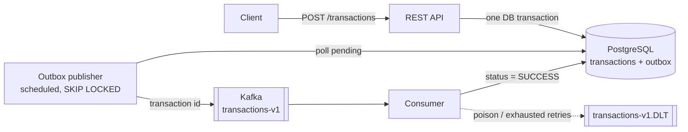

# Transaction API

[](https://github.com/devowl-teguh/java_springboot_microservice/actions/workflows/ci.yml)
 

A Spring Boot API that records transactions and simulates their asynchronous processing. A successful simulation only changes the status to `SUCCESS`; it does not charge a customer or contact a payment provider.

## Architecture



- **Transactional outbox:** the transaction row and its outbox event commit atomically, so no event is lost if Kafka is down.
- **At-least-once delivery, idempotent processing:** duplicates are safe because processing only sets the same final status.
- **Dead-letter topic:** malformed or unknown IDs are dead-lettered immediately; transient failures back off exponentially first, so one bad message never blocks a partition.
- **Errors as RFC 7807 ProblemDetail:** 400 validation (with a per-field `errors` map), malformed JSON or bad UUID, 404 not found, 409 duplicate invoice.
- **Tests:** Mockito unit tests and `@WebMvcTest` API tests run in CI; `TransactionFlowIT` runs the full flow against real PostgreSQL and Kafka via Testcontainers.

**Stack:** Java 21 · Spring Boot 3.4 · Spring Data JPA · Spring Kafka · PostgreSQL · Flyway · JUnit 5 · Mockito · Testcontainers · GitHub Actions

## Requirements

Java 21, Maven 3.6.3 or later, PostgreSQL, and a running Kafka broker. The database user must be allowed to create the `transaction_service` schema and its tables. Flyway creates them on startup. Use a test database or obtain the appropriate permissions before connecting to an existing database.

Set these environment variables (keep credentials out of source control):

```sh
export DB_URL='jdbc:postgresql://HOST:5432/DATABASE?sslmode=require'
export DB_USERNAME='YOUR_USERNAME'
export DB_PASSWORD='YOUR_PASSWORD'
export KAFKA_BOOTSTRAP_SERVERS='localhost:9092'
mvn spring-boot:run
```

For local PostgreSQL without TLS adjust the URL accordingly. Create a Kafka topic named `transactions-v1` with a suitable partition and replication count for your environment, or set `KAFKA_TOPIC` to an existing topic. The event contract v1 is a UTF-8 transaction UUID as both Kafka key and value. Configure broker access and TLS as needed for your environment.

## API

```sh
curl -X POST http://localhost:8080/transactions \
  -H 'Content-Type: application/json' \
  -d '{"invoice":"INV-001","amount":12500.00,"phoneNumber":"08123456789"}'
```

The response is `202 Accepted` with an ID and `PENDING` status. Amount must be positive, with at most 17 integer and 2 fractional digits. Invoice is unique; submitting the same invoice again returns `409 Conflict`. Phone number is stored as provided.

```sh
curl http://localhost:8080/transactions/TRANSACTION_UUID
```

The response contains the ID, invoice, amount, phoneNumber, status and createdAt. A missing ID returns `404`. Processing is asynchronous, so poll until status becomes `SUCCESS`.

## Reliability and operational notes

The transaction and outbox entry are committed together. A scheduled publisher locks up to 100 pending entries and publishes them to Kafka; on a failure the batch is retried. A crash after publication may cause duplicate messages, but processing repeatedly sets the same status. The consumer retries transient failures with exponential backoff (1s up to 30s, for about 5 minutes) and then publishes the record to `<topic>.DLT`. Malformed IDs and unknown transactions go to the DLT immediately, so a poison message never blocks its partition. Create `transactions-v1.DLT` with at least as many partitions as the main topic; records keep their original partition. Inspect and replay DLT records manually. Outbox rows are retained and require a future cleanup policy. Publishing and processing speed depend on broker, partitions, database capacity and deployment settings; load testing is needed before choosing burst capacity. This example does not implement authentication, authorization, payment integration, or production monitoring.

Run unit tests with `mvn test`. `TransactionFlowIT` starts PostgreSQL and Kafka with Testcontainers and needs Docker; run it with `mvn test -Dtest=TransactionFlowIT` (or add the Failsafe plugin to run `*IT` in `mvn verify`).
