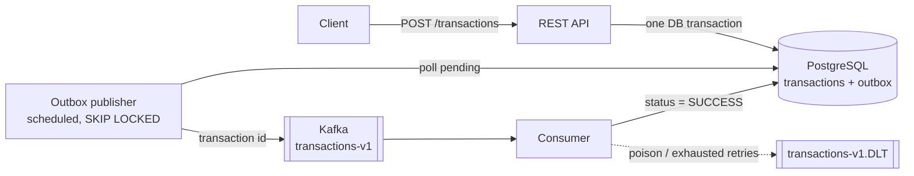
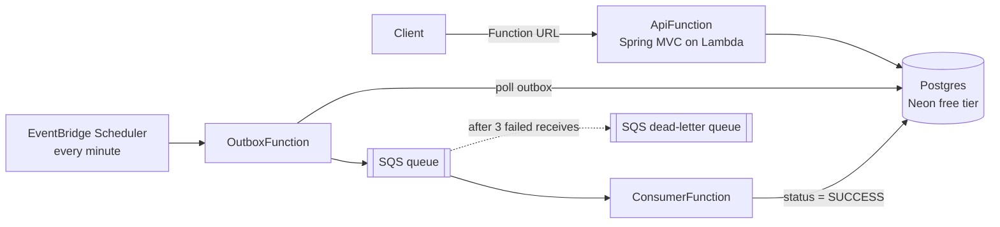

# Transaction API

[](https://github.com/devowl-teguh/java_springboot_microservice/actions/workflows/ci.yml)
 

A Spring Boot API that records transactions and simulates their asynchronous processing. A successful simulation only changes the status to `SUCCESS`; it does not charge a customer or contact a payment provider.

## Architecture



- **Transactional outbox:** the transaction row and its outbox event commit atomically, so no event is lost if Kafka is down.
- **At-least-once delivery, idempotent processing:** duplicates are safe because processing only sets the same final status.
- **Dead-letter topic:** malformed or unknown IDs are dead-lettered immediately; transient failures back off exponentially first, so one bad message never blocks a partition.
- **OpenAPI 3.1 docs:** Swagger UI plus a committed [`docs/openapi.yaml`](docs/openapi.yaml) ready to import into Postman, Insomnia or Bruno.
- **Errors as RFC 7807 ProblemDetail:** 400 validation (with a per-field `errors` map), malformed JSON or bad UUID, 404 not found, 409 duplicate invoice.
- **Tests:** Mockito unit tests and `@WebMvcTest` API tests run in CI; `TransactionFlowIT` runs the full flow against real PostgreSQL and Kafka via Testcontainers.

- **Two runtimes, one codebase:** messaging sits behind a `TransactionEventPublisher` port. The default profile uses Kafka; the `aws` profile swaps in SQS and runs on AWS Lambda for free.

**Stack:** Java 21 · Spring Boot 3.4 · Spring Data JPA · Spring Kafka · PostgreSQL · Flyway · springdoc-openapi · JUnit 5 · Mockito · Testcontainers · GitHub Actions · AWS Lambda · SQS · AWS SAM

## Deploy free on AWS (Lambda + SQS)

**Live demo (AWS Lambda, us-east-1):**
- **Try it in the browser:** [Swagger UI](https://szvtm226kimgrfzuc2etloccne0dcrmt.lambda-url.us-east-1.on.aws/swagger-ui/index.html). Open `POST /transactions`, click **Try it out**, change the invoice to something unique, and **Execute**. Then use the returned `id` in `GET /transactions/{id}`; the status changes from `PENDING` to `SUCCESS` within about a minute.
- **API base URL:** `https://szvtm226kimgrfzuc2etloccne0dcrmt.lambda-url.us-east-1.on.aws`
- The first request after a quiet period takes a few seconds while Lambda starts.

The `aws` Spring profile replaces Kafka with SQS so the whole service fits in the AWS free tier.



| | Kafka mode (default) | AWS mode (`aws` profile) |
|---|---|---|
| API | Spring Boot on port 8080 | `ApiLambdaHandler` behind a Lambda Function URL |
| Outbox relay | `@Scheduled` every second | `OutboxLambdaHandler`, EventBridge Scheduler every minute |
| Consumer | `@KafkaListener` | `SqsConsumerLambdaHandler` with partial batch failures |
| Dead letters | `transactions-v1.DLT` topic | SQS dead-letter queue (`maxReceiveCount: 3`) |

**Expected cost:** about $0. Lambda, SQS and EventBridge Scheduler stay within their always-free monthly allowances at demo traffic, and Neon has a free Postgres plan. The template also creates an AWS Budget that emails you if monthly cost passes $1.

**Trade-offs:** the first request after idle time is slower (SnapStart reduces Spring's cold start), and a transaction takes up to about a minute to reach `SUCCESS` because the outbox runs once a minute.

### Steps

1. Create a free [Neon](https://neon.tech) project and copy its **pooled** connection string as a JDBC URL, e.g. `jdbc:postgresql://HOST-pooler.REGION.aws.neon.tech/neondb?sslmode=require`.
2. Install and configure the tools:
   ```sh
   brew install awscli aws-sam-cli
   aws configure
   ```
3. Build and deploy. Either let the script read your Neon connection from `.env.local` (written by `neon init`, gitignored) and run SAM for you:
   ```sh
   scripts/deploy-aws.sh you@example.com
   ```
   or run SAM yourself and answer the prompts for `DbUrl`, `DbUsername`, `DbPassword` and `BudgetEmail`:
   ```sh
   mvn -Plambda package -DskipTests
   sam deploy --guided
   ```
   Both print `ApiUrl`. Deploy to the same AWS region as your database.
4. Try it:
   ```sh
   curl -X POST "$API_URL/transactions" -H 'Content-Type: application/json' \
     -d '{"invoice":"INV-001","amount":12500.00,"phoneNumber":"08123456789"}'
   ```

The Function URL is public with no authentication, which is fine for a demo but means anyone with the URL can create rows. Remove the stack with `sam delete` when you no longer need it.

Tests for this mode: `SqsBatchProcessorTest` and `OutboxPublisherTest` (unit), `AwsModeIT` (aws profile against real Postgres with SQS mocked) and `ApiLambdaHandlerIT` (Function URL events through the real Lambda handler).

## Run locally (macOS)

Everything except the app's own JVM runs in Docker. You need **Docker Desktop**; a JDK is only needed for option B.

**1. Configure.** Copy the example settings. It defaults to a local Postgres in Docker; to use Supabase instead, comment out block A and fill in block B (password from Supabase → Project Settings → Database).

```sh
cp .env.example .env
```

`.env` is gitignored and holds plain `KEY=value` lines (no quotes, no `export`). Both Spring Boot and Docker Compose read it, and real environment variables override it.

**2. Run.** Pick one:

*A. Everything in Docker (no JDK needed):*

```sh
docker compose --profile local-db --profile app up -d --build
```

Leave out `--profile local-db` when `.env` points at Supabase.

*B. App on your Mac with the Maven wrapper (needs JDK 21):*

```sh
brew install openjdk@21
export JAVA_HOME="$(brew --prefix openjdk@21)/libexec/openjdk.jdk/Contents/Home"   # add to ~/.zshrc to keep it
docker compose --profile local-db up -d
./mvnw spring-boot:run
```

Leave out `--profile local-db` when `.env` points at Supabase; Kafka still starts.

**3. Try it.** Open http://localhost:8080/swagger-ui.html, or:

```sh
curl -X POST localhost:8080/transactions -H 'Content-Type: application/json' \
  -d '{"invoice":"INV-001","amount":12500.00,"phoneNumber":"08123456789"}'
```

**Stop** with `docker compose --profile local-db --profile app down` (add `-v` to delete the Kafka and Postgres data).

What Compose starts: Kafka 3.8 (KRaft, `localhost:9092`), a one-shot job that creates `transactions-v1` and `transactions-v1.DLT` (3 partitions each), Postgres 16 on `localhost:5433` (profile `local-db`; port 5433 avoids clashing with a Postgres already on 5432), and the app on `localhost:8080` (profile `app`).

## Requirements for other environments

Java 21, PostgreSQL, and a Kafka broker. The database user must be allowed to create the `transaction_service` schema and its tables; Flyway creates them on startup. Use a test database, or get the right permissions, before connecting to an existing database. On Supabase, use the session pooler (port 5432), not the transaction pooler (6543), which breaks Flyway.

Configure with environment variables (keep credentials out of source control): `DB_URL` (e.g. `jdbc:postgresql://HOST:5432/DATABASE?sslmode=require`), `DB_USERNAME`, `DB_PASSWORD`, `KAFKA_BOOTSTRAP_SERVERS`, and optionally `KAFKA_TOPIC`, `OUTBOX_DELAY_MS`, `OPENAPI_SERVER_URL`, `API_DOCS_ENABLED`. Create a Kafka topic named `transactions-v1` with a suitable partition and replication count, or set `KAFKA_TOPIC` to an existing topic. The event contract v1 is a UTF-8 transaction UUID as both Kafka key and value. Configure broker access and TLS as needed for your environment. The `Dockerfile` builds a runnable image (`docker build -t transactions .`).

## API

```sh
curl -X POST http://localhost:8080/transactions \
  -H 'Content-Type: application/json' \
  -d '{"invoice":"INV-001","amount":12500.00,"phoneNumber":"08123456789"}'
```

The response is `202 Accepted` with an ID and `PENDING` status. Amount must be positive, with at most 17 integer and 2 fractional digits. Invoice is unique; submitting the same invoice again returns `409 Conflict`. Phone number is stored as provided.

```sh
curl http://localhost:8080/transactions/TRANSACTION_UUID
```

The response contains the ID, invoice, amount, phoneNumber, status and createdAt. A missing ID returns `404`. Processing is asynchronous, so poll until status becomes `SUCCESS`.

## API documentation (OpenAPI)

The spec is generated from the code with springdoc-openapi:

| What | Where |
|---|---|
| Swagger UI (try requests in the browser) | http://localhost:8080/swagger-ui.html |
| Spec, JSON | http://localhost:8080/v3/api-docs |
| Spec, YAML | http://localhost:8080/v3/api-docs.yaml |
| Spec file in the repo (no running app needed) | [`docs/openapi.yaml`](docs/openapi.yaml) |

**Import into an API client:**

- **Postman:** Import → Link, paste `http://localhost:8080/v3/api-docs` (or Import → File → `docs/openapi.yaml`). Postman creates a collection with both requests, example bodies and a `baseUrl` variable.
- **Insomnia:** Create → Import → From URL or From File, with the same URL or file.
- **Bruno:** Import Collection → OpenAPI V3 Spec → `docs/openapi.yaml`.

Without running the app, import the raw file from GitHub: `https://raw.githubusercontent.com/devowl-teguh/java_springboot_microservice/main/docs/openapi.yaml`.

The spec's server URL defaults to `http://localhost:8080`; set `OPENAPI_SERVER_URL` to change it. The API has no authentication yet, so set `API_DOCS_ENABLED=false` to turn off the spec and Swagger UI wherever they must not be public.

`OpenApiSpecTest` keeps `docs/openapi.yaml` in sync with the code. After an API change it rewrites the file and fails once; review and commit the new file, then run the tests again.

## Reliability and operational notes

The transaction and outbox entry are committed together. A scheduled publisher locks up to 100 pending entries and publishes them to Kafka; on a failure the batch is retried. A crash after publication may cause duplicate messages, but processing repeatedly sets the same status. The consumer retries transient failures with exponential backoff (1s up to 30s, for about 5 minutes) and then publishes the record to `<topic>.DLT`. Malformed IDs and unknown transactions go to the DLT immediately, so a poison message never blocks its partition. Create `transactions-v1.DLT` with at least as many partitions as the main topic; records keep their original partition. Inspect and replay DLT records manually. Outbox rows are retained and require a future cleanup policy. Publishing and processing speed depend on broker, partitions, database capacity and deployment settings; load testing is needed before choosing burst capacity. This example does not implement authentication, authorization, payment integration, or production monitoring.

Run unit tests with `./mvnw test`. `TransactionFlowIT` starts PostgreSQL and Kafka with Testcontainers and needs Docker; run it with `./mvnw test -Dtest=TransactionFlowIT` (or add the Failsafe plugin to run `*IT` in `mvn verify`).
