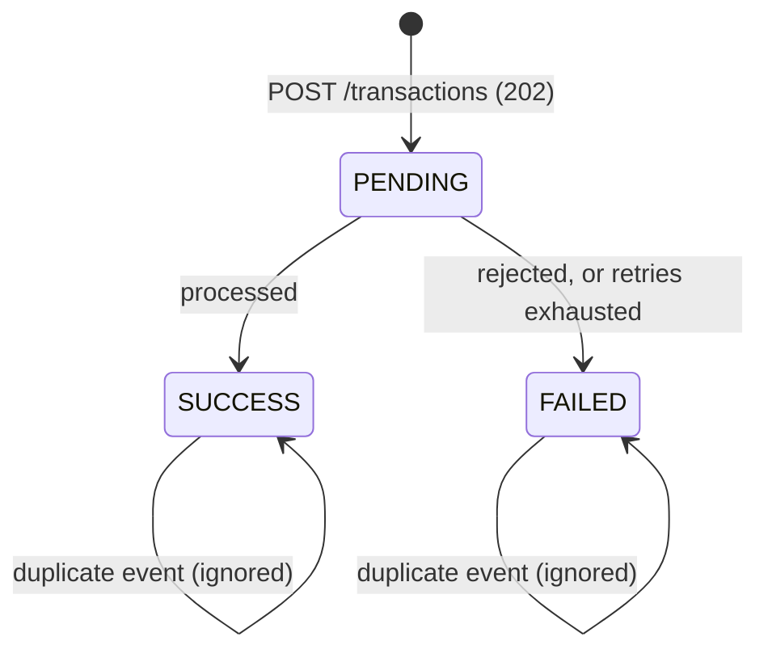
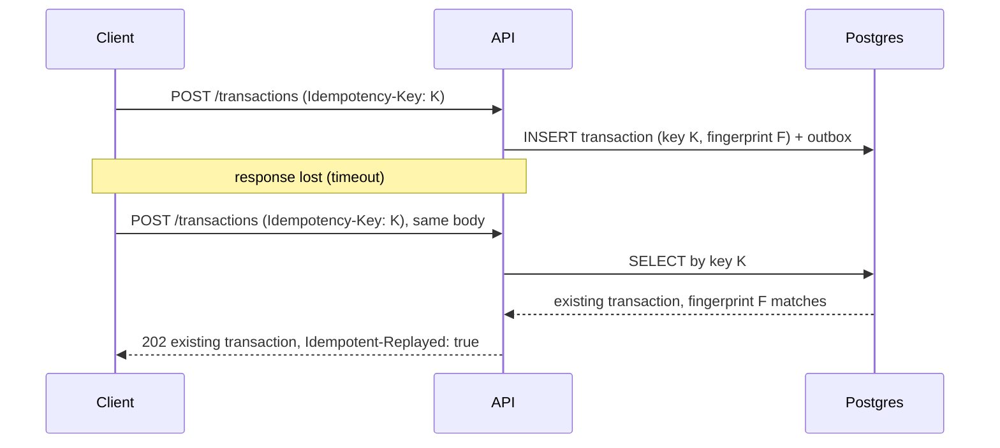
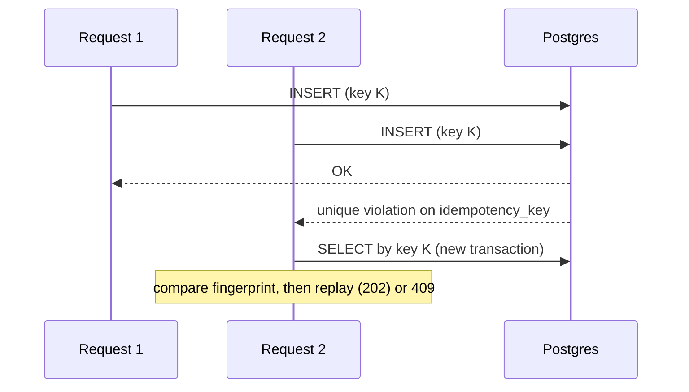

# Design 0001: Idempotent creation and a FAILED status

| | |
|---|---|
| Status | Accepted, ready for implementation |
| Author | Teguh Hadi Pratama |
| Reviewers | Backend, frontend (demo site), QA |
| Related | [ADR 0001: transactional outbox](../adr/0001-transactional-outbox.md), [ADR 0002: messaging port](../adr/0002-messaging-port-kafka-and-sqs.md) |

## Problem

1. **Retried requests are not safe.** A client that times out and retries `POST /transactions` either gets a `409` for
   its own earlier request (same invoice) or, if it changes nothing else, cannot tell whether the first attempt was
   stored. Mobile clients on unreliable networks retry by design, so they need a safe way to repeat a request.
2. **Processing can only succeed.** `process()` always sets `SUCCESS`. A transaction that is rejected, or whose event
   keeps failing, stays `PENDING` forever, and the only trace is a message in the dead-letter queue. Clients poll
   indefinitely and operators cannot see failures in the data.

## Goals

- A client can repeat a create request with the same `Idempotency-Key` and always get the same transaction back.
- Every transaction reaches a terminal state, `SUCCESS` or `FAILED`, with a reason when it fails.
- No change for existing clients that send no key.

## Non-goals

- Key expiry and cleanup (keys are kept with the transaction; revisit with data retention).
- Scoping keys per client (the API has no authentication yet; keys are global).
- Retrying or resubmitting a `FAILED` transaction.

## API contract

### `POST /transactions`: new optional header `Idempotency-Key`

1 to 255 visible ASCII characters; clients should send a UUID generated per logical request.

| Situation | Response |
|---|---|
| No key | Unchanged: `202`, or `409` "Invoice already exists" |
| New key | `202`, transaction created |
| Same key, same body | `202` with the **existing** transaction in its current state, and header `Idempotent-Replayed: true`; nothing new is stored or published |
| Same key, different body | `409` ProblemDetail: "Idempotency-Key was already used with a different request" |
| Malformed key | `400` ProblemDetail with `errors.Idempotency-Key` |

"Same body" means the same invoice, amount (compared at scale 2) and phone number, after trimming text. The server
stores a SHA-256 fingerprint of that canonical form next to the key.

### Transaction response: new status and field

```json
{
  "status": "FAILED",
  "failureReason": "Amount exceeds the processor limit of 100,000,000.00",
  "completedAt": "2026-11-18T10:16:02Z"
}
```

- `status` is `PENDING`, `SUCCESS` or `FAILED`.
- `completedAt` is when the transaction reached a terminal state (success or failure).
- `failureReason` is present only when `FAILED`. It is written for end users and never contains stack traces.

The recent list (`GET /transactions`) shows `FAILED` too. The OpenAPI spec is updated in the same pull request.

## State machine



`SUCCESS` and `FAILED` are terminal. An event for a transaction that is already terminal is acknowledged and ignored,
so at-least-once delivery stays safe.

### Why a transaction fails

| Kind | Example | Behaviour |
|---|---|---|
| Business rejection | Amount above the simulated processor limit of 100,000,000.00 | `FAILED` at once with that reason; no retries |
| Technical failure | Database unavailable while processing | Retried as today; on the **last** attempt the transaction is marked `FAILED` ("Processing failed after retries") and the message still goes to the dead-letter queue for inspection |

The processor limit is a simulated downstream rule so the demo can show a failure on demand; it is configurable with
`APP_PROCESSOR_LIMIT`.

"Last attempt" means: in AWS mode, the SQS `ApproximateReceiveCount` has reached the queue's `maxReceiveCount` (3);
in Kafka mode, the error handler's recoverer runs after backoff is exhausted.

## Sequence: client retries after a timeout



## Sequence: concurrent duplicates

Two requests with the same key can arrive together (double tap, aggressive retry). Both miss the first lookup.



The unique constraint is the source of truth; the first lookup is only an optimisation.

## Data model (migration `V3`)

| Column | Type | Notes |
|---|---|---|
| `idempotency_key` | `VARCHAR(255)` | Nullable, `UNIQUE` |
| `request_hash` | `CHAR(64)` | SHA-256 hex; required when a key is present (check constraint) |
| `failure_reason` | `VARCHAR(200)` | Nullable |
| `status` | existing | New check constraint: `PENDING`, `SUCCESS` or `FAILED` |

The migration is additive and backward compatible: existing rows keep `NULL` in the new columns.

## Test plan

| Level | Cases |
|---|---|
| Unit | State transitions and terminal-state guards; fingerprint canonicalisation (trim, amount scale); business rejection |
| `@WebMvcTest` | Replay returns `202` with `Idempotent-Replayed`; mismatch returns `409`; malformed key `400`; `FAILED` with `failureReason` in responses |
| Integration (Testcontainers) | Replay against real Postgres; **concurrent** requests with one key create exactly one row and one outbox event; rejected amount ends `FAILED` in both Kafka and AWS modes |
| Lambda handler | Final SQS attempt marks `FAILED` and still reports the message as failed so it reaches the DLQ |
| Demo site | Sends a key per submission and reuses it on retry; shows `FAILED` with the reason |

## Rollout

1. Merge with the migration; deploy (Flyway applies `V3` on start).
2. The demo site starts sending `Idempotency-Key` in the same release.
3. No client changes are required; keys are optional.

## Alternatives considered

- **Rely on the unique invoice only.** Rejected: a retry gets `409` and cannot tell whether its own request
  succeeded, and two different requests could legitimately reuse an invoice in future versions.
- **Separate idempotency table with stored responses** (Stripe style). More general, but replaying the current
  transaction state is enough here and avoids storing response bodies. Revisit if more endpoints need idempotency.
- **Mark FAILED from a separate DLQ consumer.** Decouples failure handling, but adds another moving part; marking
  on the final attempt keeps the logic next to the processing code.
