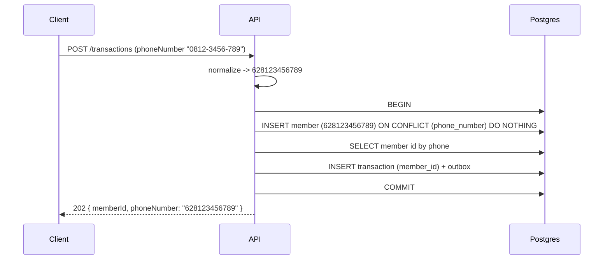

# Design 0002: Members and normalized phone numbers

| | |
|---|---|
| Status | Accepted, ready for implementation |
| Author | Teguh Hadi Pratama |
| Reviewers | Backend, frontend (demo site), QA |
| Related | [Design 0001: idempotency and FAILED](0001-idempotency-and-failed-status.md), [ADR 0003: schema per service](../adr/0003-schema-per-service.md) |

## Problem

A transaction stores the phone number exactly as typed, so the same person appears as `08123456789`, `+62 812-3456-789`
and `628123456789`. There is no member concept: nobody can list who has transacted or see one person's history.

## Goals

- Every transaction belongs to a **member**, identified by a normalized Indonesian phone number (`62…`).
- The first transaction for a phone number creates the member automatically.
- A public member list (phone numbers masked) and a member detail page with that member's transactions.

## Non-goals

- **Backfill.** Transactions created before this change keep their original phone number and no member
  (`memberId: null`). A backfill can follow as a separate migration if needed.
- Countries other than Indonesia, member names or profiles, editing or deleting members, authentication.
- Member statistics (transaction count, totals); can be added to the detail response later without breaking clients.

## Phone number rules

Input is normalized before validation and storage:

1. Remove spaces, dashes, dots and parentheses.
2. `+62…` becomes `62…`; a leading `0` (local format) becomes `62`.
3. The result must match `^62[1-9][0-9]{6,11}$` (9 to 14 digits; Indonesian national numbers are 7 to 12 digits).

| Input | Stored |
|---|---|
| `08123456789` | `628123456789` |
| `+62 812-3456-789` | `628123456789` |
| `628123456789` | `628123456789` |
| `6285544632` | `6285544632` |
| `+1 415 555 0100`, `12345`, `62 0812…` | rejected: `400`, `errors.phoneNumber` "must be an Indonesian phone number, e.g. 628123456789" |

The normalized number is what is stored on the transaction and the member, returned in responses, and used in the
`Idempotency-Key` fingerprint (Design 0001). So `0812…` and `62812…` with the same key count as the same request.

## API contract

### `POST /transactions`

Request shape unchanged. `phoneNumber` accepts the formats above. Response adds `memberId`:

```json
{ "id": "…", "phoneNumber": "628123456789", "memberId": "b1c7…", "status": "PENDING" }
```

`GET /transactions/{id}` also returns `memberId` (`null` for transactions created before this change).

### `GET /members?limit=1..50`

Newest members first. Phone numbers are masked because the list is public.

```json
[{ "id": "b1c7…", "phoneNumber": "6281****789", "createdAt": "2026-11-20T09:00:00Z" }]
```

`limit` outside 1..50 returns `400` with `errors.limit`, like `GET /transactions`.

### `GET /members/{id}`

The member with the full phone number and their 50 most recent transactions (masked phone not needed: the caller
already has the member ID).

```json
{
  "id": "b1c7…",
  "phoneNumber": "628123456789",
  "createdAt": "2026-11-20T09:00:00Z",
  "transactions": [{ "id": "…", "invoice": "INV-1", "amount": 12500.00, "status": "SUCCESS", "createdAt": "…" }]
}
```

Unknown ID: `404` ProblemDetail "Member not found"; malformed UUID: `400`.

## Sequence: first and repeat transactions for a phone number



The member, the transaction and the outbox row commit together: a failed transaction insert (for example a duplicate
invoice) never leaves an orphan member behind.

## Concurrency

Two first transactions for the same new phone number can arrive together. `INSERT … ON CONFLICT DO NOTHING` lets
both succeed without a unique-violation error (which would abort the surrounding transaction); both then read the same
member row. The unique constraint on `members.phone_number` is the source of truth.

## Data model (migration `V4`)

| Table | Column | Type | Notes |
|---|---|---|---|
| `members` | `id` | `UUID` | Primary key |
| | `phone_number` | `VARCHAR(20)` | `UNIQUE`, normalized; check constraint `^62[1-9][0-9]{6,11}$` |
| | `created_at` | `TIMESTAMPTZ` | Indexed for newest-first listing |
| `transactions` | `member_id` | `UUID` | Nullable (legacy rows), `REFERENCES members(id)`, indexed with `created_at` for the member's history |

Additive and backward compatible: existing rows are untouched.

## Test plan

| Level | Cases |
|---|---|
| Unit | Normalizer: every row of the table above, plus null, empty and boundary lengths; phone masking for 62-format numbers |
| `@WebMvcTest` | Invalid phone returns `400` with `errors.phoneNumber`; member list masks numbers and validates `limit`; member detail `200`, `404` and bad UUID `400`; `memberId` in transaction responses |
| Integration (Testcontainers) | First transaction creates a member, the second reuses it (different input formats); **concurrent** first transactions for one phone create exactly one member; duplicate invoice leaves no orphan member; idempotent replay treats `0812…` and `62812…` as the same body |
| Demo site | Members page lists masked numbers; member page shows transactions; transaction page links to its member; form hint shows accepted formats |

## Rollout

1. Merge; deploy (Flyway applies `V4`). Clients sending `08…` keep working and now receive `62…` back.
2. The demo site adds the Members pages in the same release.

## Alternatives considered

- **Reject anything that is not `62…`.** Simpler, but every client would have to normalize; normalizing once on the
  server keeps stored data consistent and the API forgiving.
- **libphonenumber.** Correct for all countries, but heavy for an Indonesia-only rule; revisit if more countries are needed.
- **Find-or-create with `SELECT` then `INSERT`.** Races under concurrency and needs retry logic; `ON CONFLICT DO NOTHING`
  is a single atomic statement in Postgres.
- **Backfill in the same migration.** Existing demo data has unvalidated phone formats; deferring keeps this change safe
  and reversible.
